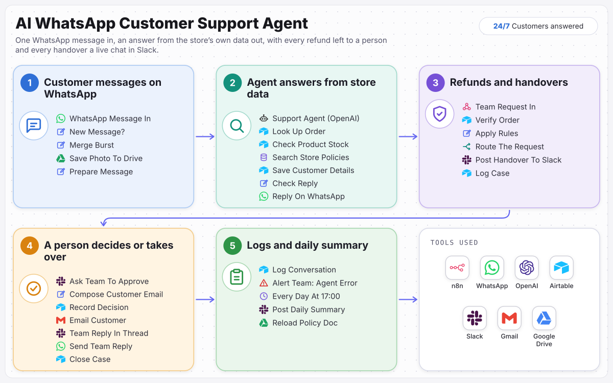

# AI WhatsApp Customer Support Agent

Customers get an answer at any hour, taken from the store's own records rather than guessed.

A WhatsApp support agent for an online outdoor gear store that answers from the store policies, looks up orders and stock, accepts photos of damaged items, sends refunds to a person in Slack for approval, and turns a handover into a live chat between the customer on WhatsApp and the team in a Slack thread. Built with n8n, the WhatsApp Business Cloud API, OpenAI and Airtable.

**Full case study:** [ramonvallejera.com/case-study/ai-customer-support-agent](https://ramonvallejera.com/case-study/ai-customer-support-agent)

## How it works

1. Customer messages on WhatsApp
2. The agent answers from store data
3. Refunds and handovers
4. A person decides
5. Logs and a daily summary

Built an n8n support agent on WhatsApp, using OpenAI, that answers only from the store policies document and the real order and stock records in Airtable. A new chat starts with a greeting that asks for the customer name, email and order number, and routine questions go to a smaller, cheaper model while refunds, complaints and anything risky go to the full model. It asks for the order number and email before sharing anything about an order. Anything involving money, and any upset or unusual case, goes to a person in Slack instead of being promised in the chat. A handed-over customer keeps chatting on WhatsApp while the team replies from a Slack thread.

## What's in this repo

| File | What it is |
|---|---|
| `workflow.json` | The whole build in one workflow, 87 nodes (78 working nodes and 9 sticky notes in 8 numbered sections), ready to import |
| `docs/process-map.svg` | The process map from the case study |

**Two ways in, one agent.** Triggers: `WhatsApp Message In`, the webhook `Chat Message In` (for a website chat), `Team Request In` (called by the agent's `Request Team Action` tool), `Team Reply In Thread` (Slack thread replies), `Every Day At 17:00`, `Reload Policies On Start` and `Load Policies (Run Manually)`.

- **WhatsApp.** `Read Message` keeps real customer messages and drops delivery and read receipts. `New Message?` skips any message WhatsApp delivers twice. Text waits 4 seconds (`Wait For More`): several messages sent in a row are joined and answered once (`Merge Burst`). The agent is keyed by the sender's number, so it remembers the conversation. Photos (a damaged item, say) are saved to Google Drive, and the agent gets the link and caption. Voice notes, stickers and files become a short note, so the agent asks the customer to type.
- **New WhatsApp chat.** On a customer's first message, after 12 hours of quiet, or after a closed case, the bot greets them, still answers their question, and asks for their name, email and order number (if they have one), skipping anything already on file. The agent's `Save Customer Details` tool records what they give on the case (`Save Details On Case`); an email is saved only if it matches the order, or if no order number was given. The team watches open chats in the Support Cases view `Open cases`.
- **Website chat.** `Chat Message In` takes `{ sessionId, message, channel }` and answers in the HTTP response.
- **Back the same way.** `On WhatsApp?` checks whether the run started from WhatsApp: if so, `Reply On WhatsApp` sends the answer; otherwise `Send Reply` returns it to the website chat. If the agent fails, `Check Reply` still gives the customer a polite reply and the team gets a Slack alert.

**The right model for each message.** `OpenAI Chat Model` picks the model per message with a fixed keyword check, not the AI: routine questions go to `gpt-5.4-mini`, and anything that mentions a refund, return, cancellation, damage, safety, legal action, anger, a repeat complaint or asking for a person (or uses `!!` or shouting) goes to `gpt-5.4`.

Fixed rules decide, not the AI: `Apply Rules` re-checks the order number and email, sends money requests (refund, replacement, exchange, cancellation, discount) on a verified order to Slack for approval, and hands everything else to a person. The approval is a Slack form, not a plain link, so a link preview can never approve anything.

**A WhatsApp handover is a live chat in Slack.** `Post Handover To Slack` posts the case with the customer's WhatsApp name, and that post becomes the case's thread. Until the case is closed the bot stays silent: the customer's messages appear in the thread, and each reply typed in the thread goes to the customer on WhatsApp and gets a ✅ reaction once WhatsApp accepts it. If the order wasn't verified, the bot asks once for the order email; when the customer sends it, the workflow checks it against the order and saves it on the case only if it matches. Typing `close` (or `close: your closing words`) in the thread closes the case, tells the customer on WhatsApp, and hands them back to the bot. If WhatsApp refuses a message (usually because the customer's last message was more than 24 hours ago), the thread says so and gives the case email to use instead.

## Set it up

1. In [Meta for Developers](https://developers.facebook.com/), create an app with the **WhatsApp** product. Meta gives you a free test number; add your own phone as a recipient to try it.
2. In n8n, open **Workflows → Import from File** and choose `workflow.json`.
3. Create these credentials and select them on the nodes that need them:

   - Airtable (personal access token) (13 nodes)
   - Slack API (bot token) (11 nodes): posts, thread replies, the ✅ reaction and `Team Reply In Thread`; subscribe the app to `message.channels` events and invite it to the channel
   - WhatsApp API (5 nodes): an access token and your WhatsApp Business Account ID, for replies and fetching photos
   - OpenAI (3 nodes): the chat model (it switches between `gpt-5.4-mini` and `gpt-5.4`) and both embeddings nodes
   - Google Drive (OAuth2) (2 nodes): the policies document and the customer photos folder
   - WhatsApp OAuth API (1 node): the app ID and secret, for `WhatsApp Message In`
   - Gmail (OAuth2) (1 node)
   - Header Auth (1 node): protects the website chat webhook

4. Replace the placeholders with your own records:

   - `THIS_WORKFLOW_ID` (3×): the workflow calls itself, so use its own ID from the URL after import
   - `YOUR_AIRTABLE_BASE_ID` (13×)
   - `YOUR_AIRTABLE_TABLE_ID` (13×): each node keeps the original table name (`Orders`, `Products`, `Support Cases`) as a hint. `Support Cases` also needs the fields `Slack Thread`, `Customer Email` and `Customer Name`.
   - `YOUR_SLACK_CHANNEL_ID` (11×): the channel that receives approvals, handovers, case threads, alerts and the daily summary
   - `YOUR_DATA_TABLE_ID` (5×): an n8n data table with the columns `messageId`, `sender`, `text` (strings) and `answered` (boolean). It remembers message IDs for 7 days, to skip duplicates and join bursts.
   - `YOUR_WHATSAPP_PHONE_NUMBER_ID` (3×): the phone number ID from the app's WhatsApp → API Setup page
   - `YOUR_DRIVE_FILE_ID` (1×): your store policies and product FAQ document
   - `YOUR_DRIVE_ID` (1×) and `YOUR_DRIVE_FOLDER_ID` (1×): where customer photos are saved

5. In `Compose Customer Email`, change the test-address pattern: this portfolio version only ever emails `you+test-…@example.com` addresses.
6. Run `Load Policies (Run Manually)` once, then activate the workflow. The policy search reloads whenever the workflow starts or is published, and n8n registers the WhatsApp webhook with Meta on activation. Every publish registers it again, so send one test message after each publish.
7. **Subscribe the WhatsApp Business Account to your app, or no messages arrive.** Activating the trigger does not do this. Call `POST https://graph.facebook.com/v21.0/{WABA_ID}/subscribed_apps` once with your access token, then send a message to the test number.

Tools: n8n, WhatsApp, OpenAI, Airtable, Slack, Gmail, Google Drive.

## Notes

- Fernhill Outdoor Supply is a fictional sample client.
- Credentials, webhook IDs, phone number IDs, pinned test data and account-specific IDs were removed before publishing. n8n assigns new webhook URLs on import.
- Built by Ramon Vallejera Jr., AI Automation Specialist.
